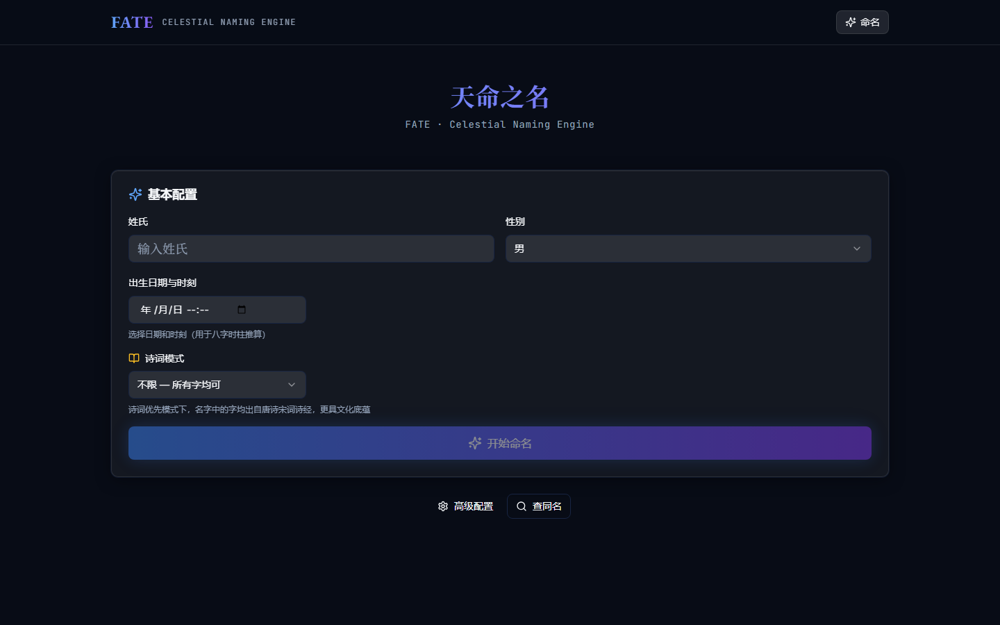
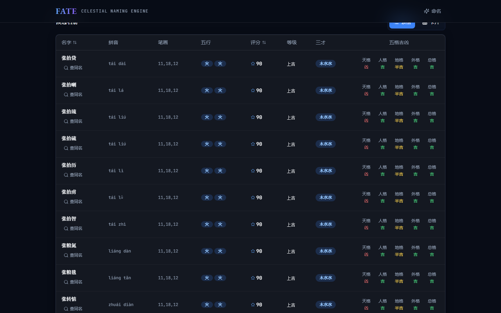

# FATE · 智能起名

输入姓氏和出生时间，FATE 会结合八字喜用神、三才五格、音韵与字义，生成一批**带解释、可比较**的候选名字。所有计算都在你自己的机器上完成，名字和生日不需要上传到任何服务。

[](https://github.com/babyname/fate/releases/latest) [](LICENSE) · [English](README_EN.md) · [开发者文档](docs/DEVELOPMENT.md)

---

## 先看效果

| 首页：填写姓氏与出生时间 | 结果页：候选名与综合评分 |
| :---: | :---: |
|  |  |

| 表格视图：逐项对比、分页 | 卡片视图：五格吉凶与同名查询 |
| :---: | :---: |
|  |  |

> 截图来自本项目 v4.3.0 实际运行的 Web 界面，见 [截图说明](docs/screenshots/README.md)。

---

## 开始使用

### 方式一：命令行（无需安装 Go）

1. 打开 [Releases 最新版](https://github.com/babyname/fate/releases/latest)，下载对应系统的压缩包并解压。
2. 若该版本附带 `fate-v*.zip` 数据库包，把它解压到程序同目录；若没有附带，需要先按方式二用源码初始化数据库（这一步需要 Go）。
3. 运行：

```bash
fate name -s 张 -b "2024/06/15 10:30" -g boy
```

常用参数：`-s` 姓氏、`-b` 出生日期时刻、`-g` 性别（`boy`/`girl`）、`-f` 需要避开的字、`-o` 输出到文件。完整参数表见 [开发者文档](docs/DEVELOPMENT.md)。

### 方式二：Web 界面（推荐，可视化对比）

需要 **Go 1.22+**。前端已内嵌，生产运行不需要 Bun / Node。

```bash
git clone https://github.com/babyname/fate.git
cd fate
go mod download
go run ./cmd/dbinit      # 初始化本地数据库，只需一次
go run ./cmd/server      # 启动服务
```

浏览器打开 **http://localhost:18080** 。填写姓氏、出生日期与性别，点击「开始命名」即可。

> Web 服务接口统一为 `/api/v1/*`；接口清单见 [开发者文档](docs/DEVELOPMENT.md)。

---

## 你会得到什么

- **可解释的评分**：文化印象、五行八字、生肖、五格数理、音韵五个维度分别计分，详情页列出每一项明细。半吉按独立档位计分，不再被当作「吉」加分。
- **八字喜用神**：按出生时间排四柱，判断喜用神，再据此筛选用字。
- **五格与三才**：天格、人格、地格、外格、总格的数理吉凶，以及三才配置，在名册和详情页直接可见。
- **可比较的候选名册**：表格视图排序与分页、卡片视图展示五格吉凶；「探索更多」逐批补充新名字，取尽时明确提示。
- **官方同名人数查询**：一键复制全名，打开所选地区的官方查询入口；查到的结果可以手动记录，只保存在当前浏览器，不会上传。

---

## 常见问题

**我的数据会上传吗？**
不会。生成与评分全部在本地进程完成。同名查询功能只是把全名复制到剪贴板并打开一个官方网页，记录结果也只写入本机浏览器存储。

**为什么必须填出生时间？**
出生时间用于排八字与判断喜用神，进而影响五行用字的筛选。日期格式为 `YYYY/MM/DD HH:MM`。

**分数越高就一定越好吗？**
分数是五维加权的可解释参考，不是唯一标准。建议同时看详情页的五行、三才、音韵明细，以及字义和你的家庭偏好。

**「探索更多」点不出新名字？**
每轮可探索的名字有上限；界面会提示本轮已全部展示，可返回命名结果或重新生成。

**「姓名测分」「诗词搜索」在哪？**
这两个入口对应的后端能力尚未实现，v4.3.0 起已从界面下线，避免点了之后报错。恢复计划见 [#146](https://github.com/babyname/fate/issues/146)。

---

## 开发者入口

架构、目录结构、Web API、代码集成、编译与发布流程已迁到 [docs/DEVELOPMENT.md](docs/DEVELOPMENT.md)；问题分析与版本变更见 [issue #147](https://github.com/babyname/fate/issues/147)。

## License

[MIT](LICENSE)
