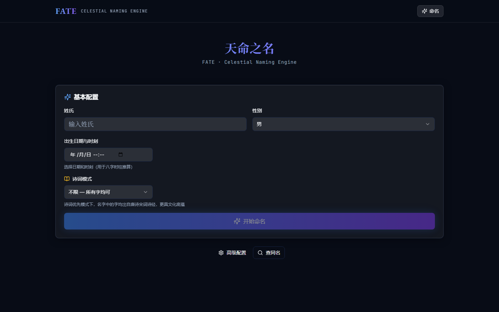

# FATE · Name Generation

Enter a surname and a birth time; FATE combines Bazi elemental preferences, three-talent/five-grid numerology, phonetics and character meaning into a shortlist of **explained, comparable** names. Everything runs locally — names and birth dates are never uploaded.

[](https://github.com/babyname/fate/releases/latest) [](LICENSE) · [中文](README.md) · [Developer docs](docs/DEVELOPMENT.md)

---

## Screenshots

| Home | Results |
| :---: | :---: |
|  |  |

| Table view | Card view |
| :---: | :---: |
|  |  |

Captured from the running v4.3.0 Web UI; see [capture notes](docs/screenshots/README.md).

---

## Get started

### CLI (no Go toolchain required)

1. Download the archive for your OS from the [latest release](https://github.com/babyname/fate/releases/latest) and unpack it.
2. If the release includes a `fate-v*.zip` database bundle, unpack it next to the binary; otherwise initialise the database from source as shown below.
3. Run:

```bash
fate name -s 张 -b "2024/06/15 10:30" -g boy
```

Options: `-s` surname, `-b` birth date/time, `-g` gender (`boy`/`girl`), `-f` characters to avoid, `-o` output file.

### Web UI (recommended)

Requires **Go 1.22+**. The frontend is embedded; Bun/Node is not needed at runtime.

```bash
git clone https://github.com/babyname/fate.git
cd fate
go mod download
go run ./cmd/dbinit      # one-time local database setup
go run ./cmd/server
```

Open **http://localhost:18080**, fill in surname, birth date and gender, then click "开始命名". All HTTP endpoints live under `/api/v1/*`; see the [developer docs](docs/DEVELOPMENT.md).

---

## What you get

- **Explainable scoring** — five weighted dimensions (cultural impression, Bazi elements, zodiac, five-grid numerology, phonetics), each with a breakdown. Half-lucky grids are scored in their own tier.
- **Bazi preference** — four pillars from the birth time, used to filter characters by element.
- **Five grids & three talents** — luck ratings for all five grids, visible in the shortlist and detail view.
- **Comparable shortlist** — sortable/paginated table, cards with grid luck, and batched "explore more" with an explicit exhausted state.
- **Official same-name lookup** — copy the full name, open an official query page, and optionally record the result locally in your browser.

## FAQ

**Is my data uploaded?** No. Generation and scoring are local; the same-name feature only copies text and opens an official page. Records stay in browser storage.

**Why is birth time required?** It drives the Bazi calculation and elemental filtering. Format: `YYYY/MM/DD HH:MM`.

**Is the highest score always the best name?** The score is a weighted, explainable reference, not a verdict. Check the detail breakdown, character meanings and your own preferences.

**Where are name scoring and poetry search?** Their backend endpoints are not implemented; the UI entry points were removed in v4.3.0 to avoid broken clicks. See [#146](https://github.com/babyname/fate/issues/146).

---

Architecture, directory layout, API reference, library usage and release engineering: [docs/DEVELOPMENT.md](docs/DEVELOPMENT.md). Cleanup analysis: [#147](https://github.com/babyname/fate/issues/147).

## License

[MIT](LICENSE)
